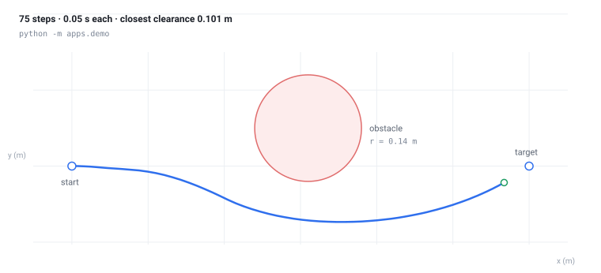

# Smart Robotic Car with LLM Interaction

Say **"Hey car, come here."** — the sentence becomes an action, the action
becomes a motion, and the car drives to you.

This repository holds the parts of that loop that run **without hardware**: the
intent parser, the navigation controllers, and a simulation that closes the
loop, all in standard-library Python with a test for every behaviour claimed
below. The hardware bridge, microphone and camera are listed under
[Not built yet](#not-built-yet) — this README only claims what `pytest` proves.

```console
$ python -m apps.demo
action: GOTO_USER
arrived: True
steps: 75
pose: (1.13, -0.04, 0.52)
closest clearance: 0.101 m
```



The curve is the run above, not an illustration: `python -m scripts.draw_path`
records the poses and writes `docs/demo-path.svg`, so a change to the controllers
shows up as a different path.

## What runs today

| Piece | Where | What it does |
| --- | --- | --- |
| Intent parser | `intent/parser.py` | Maps a spoken sentence to `GOTO_USER` / `STOP` / `MOVE` / `TURN` / `FOLLOW`; anything else becomes `SMALLTALK`, so unknown speech moves nothing. |
| Kinematics | `sim/car.py` | Unicycle model (`x += v·cosθ·dt`, …) with speed and turn-rate limits and heading wrap. |
| Range sensing | `sim/world.py` | Ray-marched distance to circular obstacles, capped at the sensor's range. |
| Obstacle avoidance | `nav/avoid.py` | Three range readings → `(v, w)`: cruise when clear, slow and steer when close, turn in place when blocked. |
| Go-to-user | `nav/go_to.py` | Heading controller plus speed ramp; "arrived" is a 8 cm tolerance, about the size of the car. |
| Dialogue | `llm/echo_agent.py` | Returns `{reply, action, args}` so the base can act without re-parsing. |
| HTTP API | `apps/api_server.py` | `POST /chat {text}` → the same shape (needs `fastapi`). |

```console
$ python -m pytest          # 31 tests
$ python -m apps.demo       # closed loop, exits non-zero if it collides
```

The demo is a smoke test on purpose: it drives from the origin to `(1.2, 0)`
with an obstacle parked at `(0.62, 0.10)`, and exits non-zero unless the car
arrives **and** keeps positive clearance.

## How the loop fits together

```
sentence ──► intent/parser ──► action ──► nav/go_to ──┐
                                            │          ├─► sim/car ─► pose
                       sim/world (ranges) ──► nav/avoid ┘
```

Every arrow is a function with a test. None of them need a network, a GPU or a
robot, which is why the whole thing runs in CI on three operating systems.

## Design decisions worth naming

- **The parser is a rule table, not a model.** It is the contract an LLM
  tool-call has to match; when the model is plugged in, the tests stay valid.
- **Unknown text moves nothing.** `SMALLTALK` exists so a misunderstanding
  cannot become motion.
- **A dead-on obstacle picks a side.** With equal left and right readings the
  proportional term is zero, and holding course would drive straight into the
  obstacle — so a tie turns rather than cruises. There is a test for it.
- **Simulation first.** The controllers were written against a simulated base
  so their behaviour is reproducible and reviewable; the hardware bridge then
  only has to move bytes.

## Repository layout

```
apps/     demo (closed loop) and the FastAPI server
intent/   sentence → action
nav/      go_to and avoid controllers
sim/      unicycle kinematics and ray-marched range sensing
llm/      dialogue adapter
tests/    31 tests: kinematics, sensing, control, intent, closed loop
```

## Not built yet

Listed so nothing here reads as finished when it is not: offline ASR (Vosk),
TTS (pyttsx3), a Raspberry Pi → Arduino serial bridge, a camera/OpenCV
perception stage, on-device systemd deployment, and telemetry logging. The
`docs/` and `speech/` folders an earlier version of this README promised do not
exist.

## Requirements

Python 3.10+. Runtime code is standard library only; `pytest` is needed for the
tests (`pip install -r requirements-dev.txt`) and `fastapi` + `uvicorn` only for
the HTTP face.

## License

No license file, so the default applies: all rights reserved. Open an issue if
you want a permissive license here.
